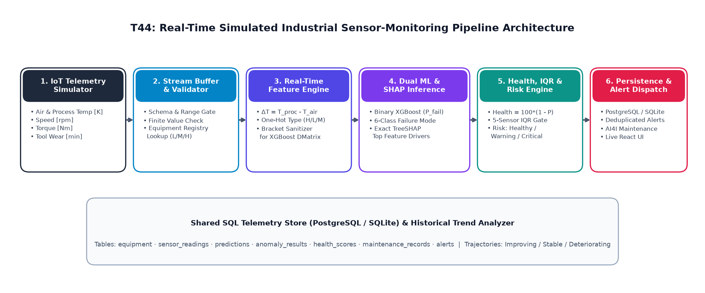
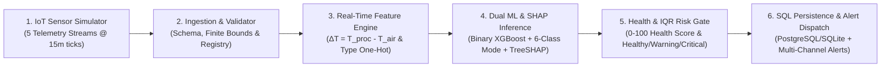

# Advanced Task T44: Simulated Sensor-Monitoring Pipeline Architecture & Prototype

## 1. Architecture Diagram (Mermaid & Visual PNG)

---

## 2. Simulated 20-Tick Progressive Degradation Stream (`SIM-CNC-01`)

The prototype (`src/sensor_monitoring_pipeline.py`) simulates a CNC spindle progressing through four realistic physical regimes:
1. **Steps 1–8 (`Phase 1: Normal Operation`)**: Healthy baseline operation (`Health Score = 99–100`, `Risk = Healthy`).
2. **Steps 9–14 (`Phase 2: Early Degradation`)**: Rising tool wear and torque trigger early `Warning` risk classification before failure occurs.
3. **Steps 15–18 (`Phase 3: Critical Failure Stress`)**: High tool wear ($>215\text{ min}$), high torque ($>65\text{ Nm}$), and narrow $\Delta T$ trigger `Failure` predictions (`Probability > 85%`, `Health Score < 15`, `Risk = Critical`) with specific failure mode attribution and emergency maintenance dispatch.
4. **Steps 19–20 (`Phase 4: Post-Maintenance Reset`)**: Tool replacement restores health score to `99.9 / 100` (`Healthy`).

| Step | Operating Phase | Air [K] | Proc [K] | Speed [rpm] | Torque [Nm] | Wear [min] | Prediction (Prob) | Health Score | Risk Level | Specific Mode (T38) |
| :---: | :--- | :---: | :---: | :---: | :---: | :---: | :---: | :---: | :---: | :--- |
| `1` | Phase 1: Normal Operation | `298.42` | `308.63` | `1534` | `40.65` | `34` | **No Failure** (`0.1%`) | `99.9` (Good) | **Healthy** | No Failure |
| `2` | Phase 1: Normal Operation | `298.47` | `308.72` | `1522` | `40.49` | `48` | **No Failure** (`0.1%`) | `99.9` (Good) | **Healthy** | No Failure |
| `3` | Phase 1: Normal Operation | `298.53` | `308.69` | `1521` | `41.68` | `62` | **No Failure** (`0.1%`) | `99.9` (Good) | **Healthy** | No Failure |
| `4` | Phase 1: Normal Operation | `298.54` | `308.76` | `1512` | `42.37` | `76` | **No Failure** (`0.1%`) | `99.9` (Good) | **Healthy** | No Failure |
| `5` | Phase 1: Normal Operation | `298.64` | `308.86` | `1502` | `43.33` | `90` | **No Failure** (`0.1%`) | `100.0` (Good) | **Healthy** | No Failure |
| `6` | Phase 1: Normal Operation | `298.86` | `308.99` | `1489` | `43.94` | `104` | **No Failure** (`0.1%`) | `100.0` (Good) | **Healthy** | No Failure |
| `7` | Phase 1: Normal Operation | `298.76` | `309.02` | `1479` | `44.23` | `118` | **No Failure** (`0.1%`) | `100.0` (Good) | **Healthy** | No Failure |
| `8` | Phase 1: Normal Operation | `299.12` | `309.31` | `1474` | `45.21` | `132` | **No Failure** (`0.1%`) | `99.9` (Good) | **Healthy** | No Failure |
| `9` | Phase 2: Early Degradation | `299.75` | `308.83` | `1422` | `50.2` | `147` | **No Failure** (`0.3%`) | `99.7` (Good) | **Healthy** | No Failure |
| `10` | Phase 2: Early Degradation | `300.0` | `308.96` | `1404` | `52.4` | `159` | **No Failure** (`0.4%`) | `99.6` (Good) | **Healthy** | No Failure |
| `11` | Phase 2: Early Degradation | `300.25` | `309.09` | `1386` | `54.6` | `171` | **No Failure** (`0.6%`) | `99.4` (Good) | **Healthy** | No Failure |
| `12` | Phase 2: Early Degradation | `300.5` | `309.22` | `1368` | `56.8` | `183` | **No Failure** (`15.5%`) | `84.5` (Good) | **Healthy** | No Failure |
| `13` | Phase 2: Early Degradation | `300.75` | `309.35` | `1350` | `59.0` | `195` | **Failure** (`77.0%`) | `23.0` (Poor) | **Critical** | OSF (Overstrain) |
| `14` | Phase 2: Early Degradation | `301.0` | `309.48` | `1332` | `61.2` | `207` | **Failure** (`99.8%`) | `0.2` (Poor) | **Critical** | HDF (Heat Dissipation) |
| `15` | Phase 3: Critical Failure Stress | `302.15` | `309.95` | `1315` | `65.5` | `218` | **Failure** (`99.9%`) | `0.1` (Poor) | **Critical** | HDF (Heat Dissipation) |
| `16` | Phase 3: Critical Failure Stress | `302.5` | `310.2` | `1300` | `68.0` | `226` | **Failure** (`99.9%`) | `0.1` (Poor) | **Critical** | HDF (Heat Dissipation) |
| `17` | Phase 3: Critical Failure Stress | `302.85` | `310.45` | `1285` | `70.5` | `234` | **Failure** (`99.9%`) | `0.1` (Poor) | **Critical** | HDF (Heat Dissipation) |
| `18` | Phase 3: Critical Failure Stress | `303.2` | `310.7` | `1270` | `73.0` | `242` | **Failure** (`99.9%`) | `0.1` (Poor) | **Critical** | HDF (Heat Dissipation) |
| `19` | Phase 4: Post-Maintenance Reset | `298.0` | `308.5` | `1560` | `38.0` | `0` | **No Failure** (`0.1%`) | `99.9` (Good) | **Healthy** | No Failure |
| `20` | Phase 4: Post-Maintenance Reset | `298.0` | `308.5` | `1560` | `38.0` | `5` | **No Failure** (`0.1%`) | `99.9` (Good) | **Healthy** | No Failure |
